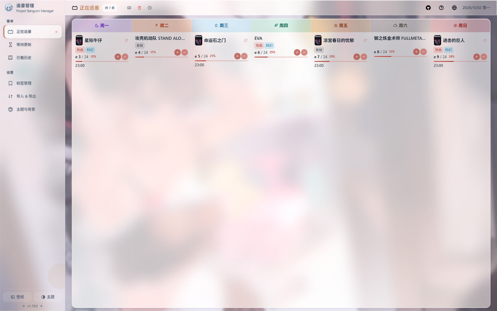
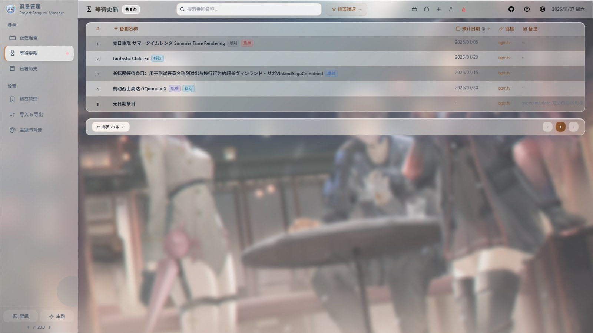
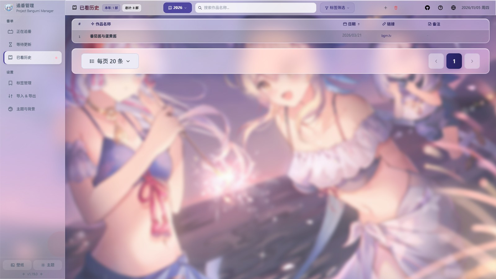
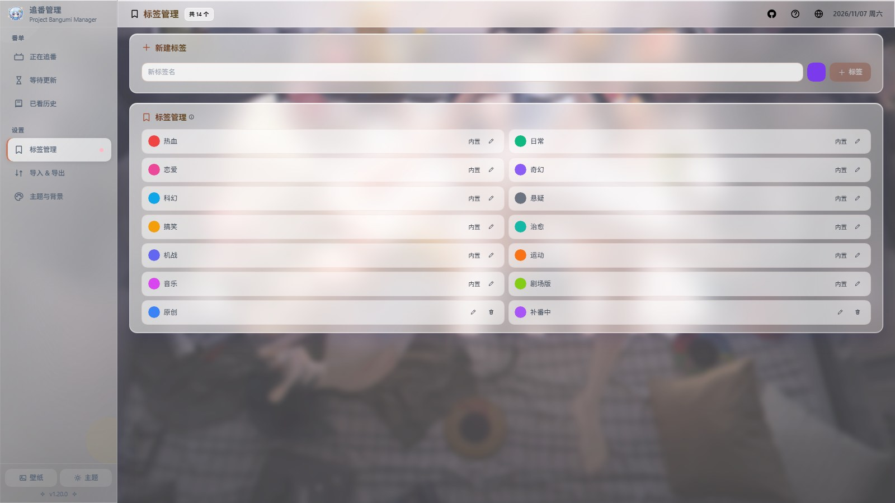
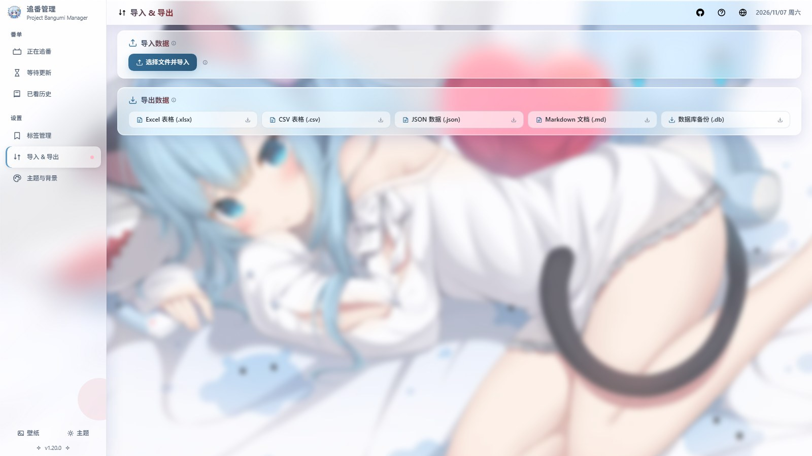
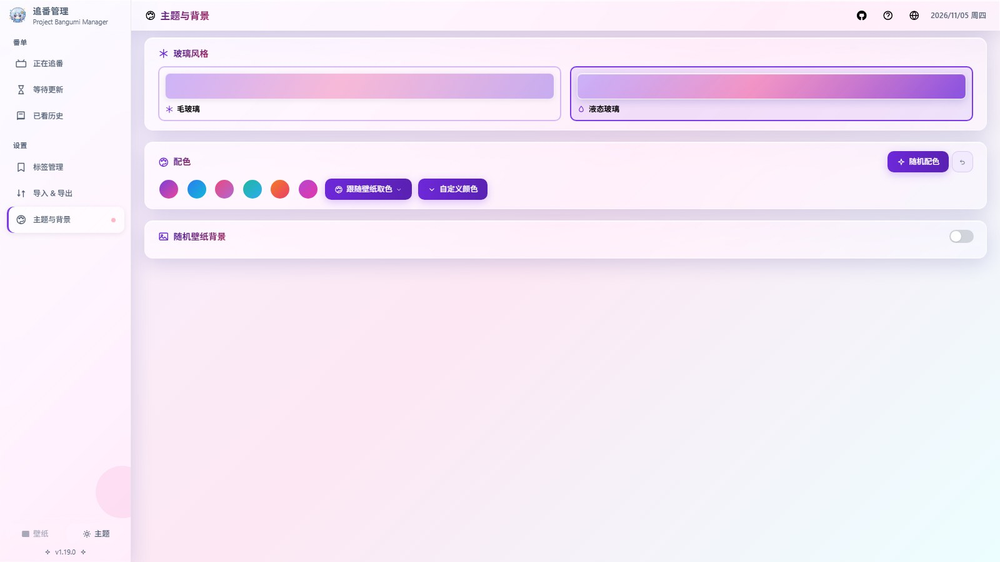
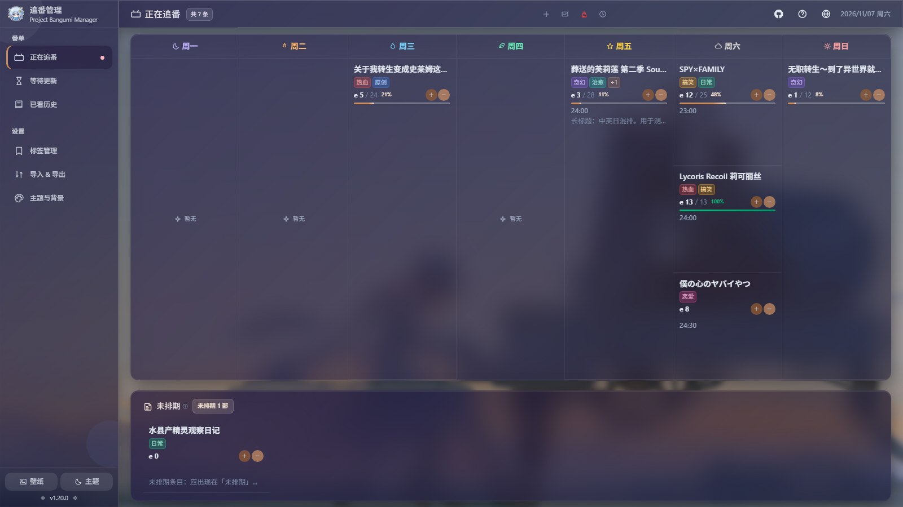

<p align="center">
  
</p>

<h1 align="center">PBM — Project Bangumi Manager</h1>

<p align="center">
  <b>One HTML file that holds your whole watch list.</b><br />
  Runs in your browser · ships as a single file · every byte of data stays on your machine
</p>

<p align="center">
  <a href="https://emilelu.github.io/pbm.html"></a>
  
  
  
  
  
</p>

<p align="center">
  <a href="README.md">中文</a> · <b>English</b> · <a href="README.ja.md">日本語</a>
</p>



## Get started in three steps

1. Grab the built `dist/index.html`, or just open the [live demo](https://emilelu.github.io/pbm.html)
2. **Double-click** that HTML file — that's the whole install (it even runs from `file://`, WASM is inlined)
3. Moving machines? Sidebar → "Settings → Import & Export" → "Database backup (.db)", carry the file with you

No Node runtime, no account, no server. And with no backend there is nothing that can expire.

## What it is

PBM covers the whole life of a show: **Waiting → Watching → Watched**.

The project started in February 2020 as a single Excel sheet — back then tracking anime meant
manually filling in weekly cells. Six years later it is still **one file**, but the cells grew into
a week view, progress bars, tag filters, themeable wallpapers, and five import/export formats.

The database is real SQLite compiled to WASM (`sql.js`) running in your browser, persisted to
IndexedDB. Close the tab, cut the network, copy the file to an offline machine — the data is still there.

## Why use it

- 📅 **Week view** — Monday through Sunday, one column per day; what's on today and how many shows are left, at a glance
- 🔄 **Three states** — move entries between Waiting, Watching and Watched with a click or context menu, progress follows along
- 🏷️ **Tags** — 12 built-in tags (Action / Slice of Life / Romance / Fantasy…) plus your own; multi-select (OR) filtering on list pages
- 🎨 **Appearance** — 6 preset palettes, colors sampled from the wallpaper, random-per-refresh; frosted glass or liquid glass
- 🌏 **Three languages** — 中文 / English / 日本語 (597 keys aligned key by key), plus a proper dark mode
- 📦 **Five formats** — xlsx / csv / json / md / db: full backups as well as human-readable text exports
- 🔒 **Nothing leaves the browser** — no backend, no analytics, no sign-in; the data is only on your own disk

## Screenshots

### Watching — laid out Monday to Sunday

Columns per weekday, sorted by air time, progress right on the card as `e 8 / 12  67%`.
One click on the plus or minus logs an episode. Anything from your waiting list that airs this
month is called out at the top of the page.


### Waiting — queued up before it airs

Table plus paging, sorted by expected date, with batch add and drag-to-reorder. The "seasonal anime"
button opens the current season page on yuc.wiki, so adding a show takes one click. Table columns
auto-fit their content — links and notes are capped, the name column takes the rest and ellipsizes —
so wide screens waste no space; on narrow screens the table scrolls inside its card instead of
squeezing every column.



### History — filed by year

Grouped by year with this-year and all-time totals; each row of the year menu carries inline
edit / delete buttons, so renaming, deleting or adding a year never requires switching the filter.
Each entry carries tags, a link and a note, so future-you can remember why it was on the list.



### Tags — built-ins can't be deleted, but can be renamed and recolored

Twelve built-in tags work out of the box; custom tags get their own color. Renaming propagates to
every entry. Built-ins can be renamed and recolored but never deleted — so their meaning can't
quietly disappear.



### Import & Export — five formats, both directions

Import detects the format from the file type, no picker needed. Export is one click per format.
`.db` is a full database backup, and a restore takes a rollback snapshot first.



### Theme & background — change the wallpaper too

Frosted and liquid glass, 6 presets, palette sampled from the wallpaper, and a random wallpaper
background that can either rotate on every launch or be pinned. Dimming and blur are both tunable.
Wallpaper sampling and preview go through a self-hosted CORS proxy (configured at the top of
`useAppearance.js`); with no reachable proxy they degrade silently, and custom direct URLs are
never sent to any proxy.



### Dark mode

Not a filter over the light theme: glass layering, text contrast and the wallpaper mask are each
tuned separately for dark.



## Run from source

```bash
pnpm install
pnpm dev      # dev server
pnpm build    # outputs dist/index.html (one HTML file, WASM inlined)
pnpm test     # 476 tests / 14 files
```

The built file is about 1.6 MB, roughly 709 KB gzipped. The WASM is gzipped, then base64-inlined;
at runtime it is restored with the native `DecompressionStream('gzip')` when available, falling back
to a bundled pure-JS inflate. Neither path touches the network, so both work from `file://`.

<details>
<summary><b>Feature breakdown by page</b></summary>

| Page | Capabilities |
|---|---|
| Watching `/watching` | Week grid, time sorting, episode ± (zero-padded and decimal), progress percentage, link templates, monthly reminders, one-click add from the top bar |
| Waiting `/remaining` | Table + paging, date sorting, drag to reorder, batch add, seasonal anime shortcut, top-bar search & tag filter |
| History `/watched` | Year grouping, date sorting, inline year edit / delete / create, this-year and total stats, top-bar search / tag / year filters |
| Tags `/tags` | 12 built-ins + custom; create, rename, recolor, delete; built-ins cannot be deleted, renames propagate |
| Theme `/appearance` | 6 preset palettes, sample from wallpaper or randomize per refresh, frosted / liquid glass, mask & blur tuning |
| Import `/import` | Excel import page: sheet detection, week-layout parsing, merged year cells, hyperlinks, import log |
| Import & Export `/transfer` | Format detected on import; export as xlsx / csv / json / md / db |

**Global**

- Chinese / English / Japanese (597 aligned keys), CJK font family per language; light / dark / follow-system
- Collapsible sidebar (15rem ↔ 4rem) grouped into lists / settings, icons with tooltips when collapsed
- One shared color picker; root font size scales with the viewport for high-DPI screens
- Menus, tooltips and the date/time/color panels anchor to the cursor or trigger, flip and clamp
  inside the viewport, and share one pop transition; time is picked from a button grid
  (24 `HH:00` + 12 five-minute `:MM` buttons, manual input kept)
- List-clearing actions use a broom icon, distinct from the trash icon reserved for delete,
  consistent across all three pages and their confirm dialogs
- Responsive shell: search, tag and year filters live in the global top bar above 1100px and
  collapse to icons (tap for a panel input) at ≤1100px; page actions fold into a more-actions menu
  at ≤1100px, the sidebar collapses to icons at ≤900px, and the title, counters and date stay on
  one line; under pressure the top bar shrinks the search box first (10rem floor) and ellipsizes
  the title and badges instead of hiding or overlapping them
- Table columns auto-fit their content — links and notes capped, the name column takes the rest
  and ellipsizes — so wide screens waste no space; on narrow screens the table scrolls inside its card
- Skeleton rows render until the first data arrives, instead of flashing an empty state
- `.db` backup with a rollback snapshot before a restore; structured imports report success/failure counts
- Fully keyboard operable, focus trap, Esc to close; oversized dialogs cap at the viewport height
  and scroll internally; help dialog collects shortcuts in one place
- Honours `prefers-reduced-motion`: animations and transitions drop to near-zero duration

</details>

<details>
<summary><b>Tech stack and project layout</b></summary>

Vue 3 · Vite 6 · TailwindCSS 3 · vue-router 4 · sql.js 1.14 (WASM) · SheetJS 0.20 · vite-plugin-singlefile

```
src/
├── App.vue        root component (sidebar groups/collapse, import & export menus)
├── components/    AppIcon · WatchingCard · ColorPicker · TagSelector · TagFilter · HelpDialog
├── composables/   theme, appearance, i18n, dates, episodes, focus trap…
├── db/            index.js (schema/migrations), excelImporter, excelExporter, structuredImporter
├── locales/       three language packs, zh / en / ja (597 keys)
├── router/        routes (including /tags, /appearance, /transfer)
├── views/         Watching · Waiting · History · Import · Tags · Theme · Import & Export
└── style.css      global styles and theme variables
```

</details>

<details>
<summary><b>Implementation notes and the traps we hit</b></summary>

Every item below was a real bug with a comment left in the code. Worth reading before refactoring.

**Single file and `file://`**
- The WASM has to be inlined: under `file://`, `fetch`ing it is blocked by CORS outright. The inline scheme is gzip + base64
- The decompressed bytes are validated for both length and the WASM magic number; a broken decompressor throws immediately rather than feeding garbage to WebAssembly
- Both `index.html` and the entry declare `darkreader-lock`: Dark Reader's dynamic mode strips `::before/::after`, which makes the wallpaper vanish

**SQLite WASM + IndexedDB**
- Persisting must not `db.export()` on every write (that is O(n²)). Writes only mark the DB dirty; a microtask merges them into one export + one IndexedDB transaction
- A failed load **must not** create an empty database: better to stop with an error than overwrite the user's data
- Importing a `.db` builds a candidate instance first and only swaps it in after the schema check passes, so a corrupt file can't leave the session at `database is closed`
- When `addWatched({ name })` gets no date, normalization must return an empty string rather than `undefined`; otherwise sql.js throws the bare string `tried to bind a value of an unknown type (undefined)`
- For year queries the prefix upper bound must be `label + '0'` (not `label + '/1'`), or `2021/10`–`2021/12` are dropped silently

**Positioning and animation**
- Any ancestor with `backdrop-filter` (most `.glass` cards here) becomes the containing block for `position: fixed` children
- So every dialog, tooltip and dropdown is `Teleport`ed to body and positioned with `fixed` + `getBoundingClientRect()`
- Theme colors are **RGB triples** (`--c-primary: 124 58 237`); write `rgb(var(--c-primary) / 0.2)`. `rgba(var(--c-primary), 0.2)` is invalid and the declaration is dropped silently
- `v-if` and `v-for` must not sit on the same element; leaving elements must be taken out of flow, or Vue's FLIP measures zero movement and the rest jump instantly
- No infinite animations inside a glass subtree: that glass would recapture and re-blur the background every frame and peg the GPU

**i18n**
- 60 lines of hand-rolled i18n instead of vue-i18n: fallback chain is current language → Chinese → raw key, so missing translations show up immediately
- The three packs must keep identical keys and `{name}` placeholders, enforced by `tests/i18n.test.js`

</details>

## Documentation

- [Changelog](CHANGELOG.md)
- [Code audit and fix report](review/SUMMARY.md)
- [中文 README](README.md) · [日本語 README](README.ja.md)

## License

MIT
