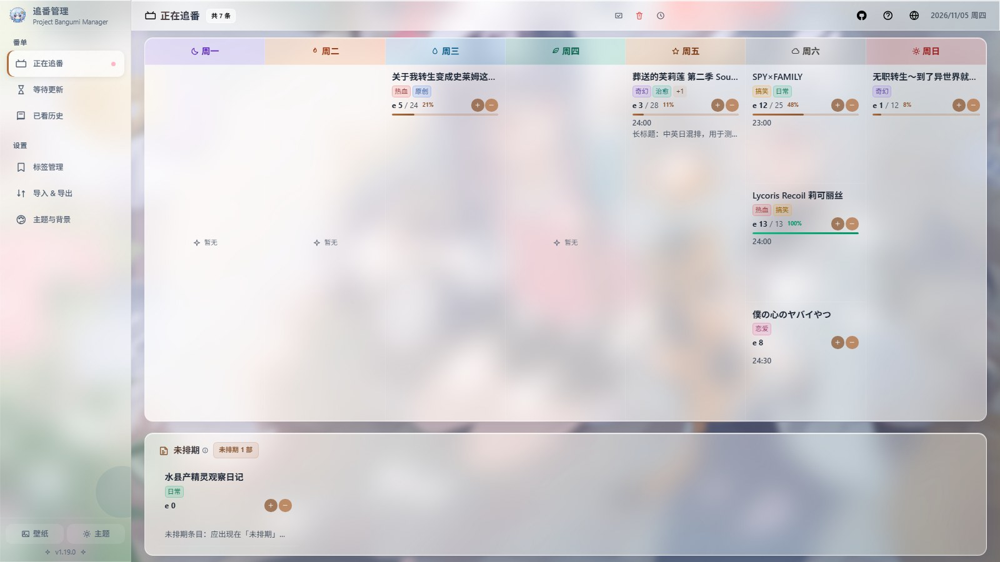
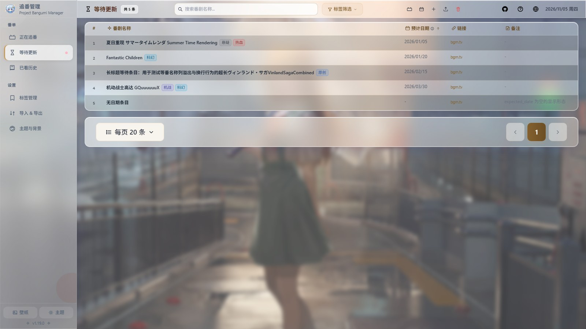
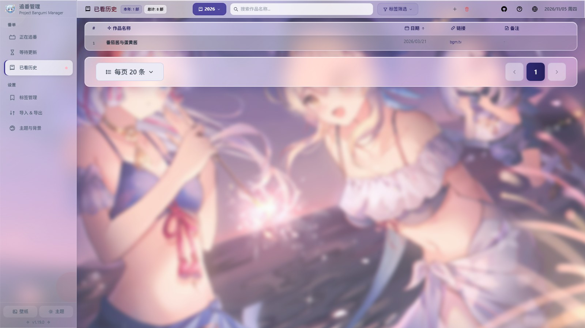
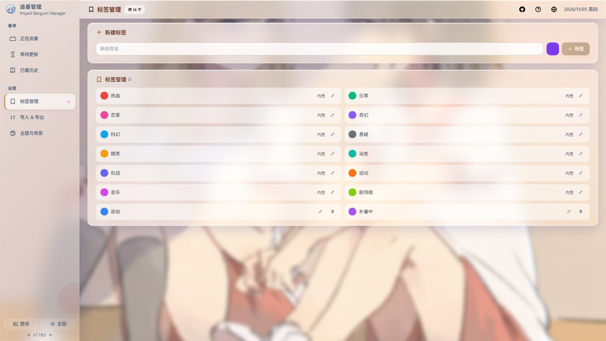
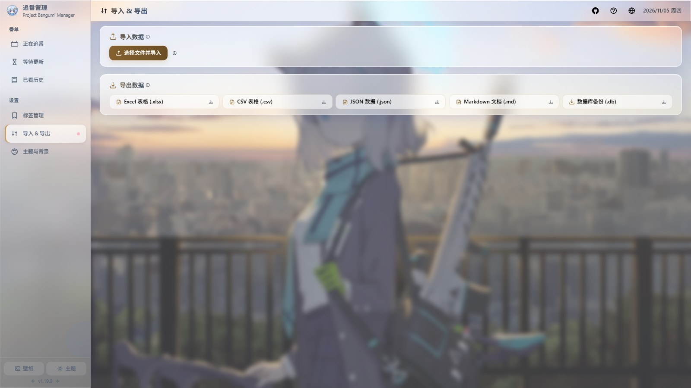
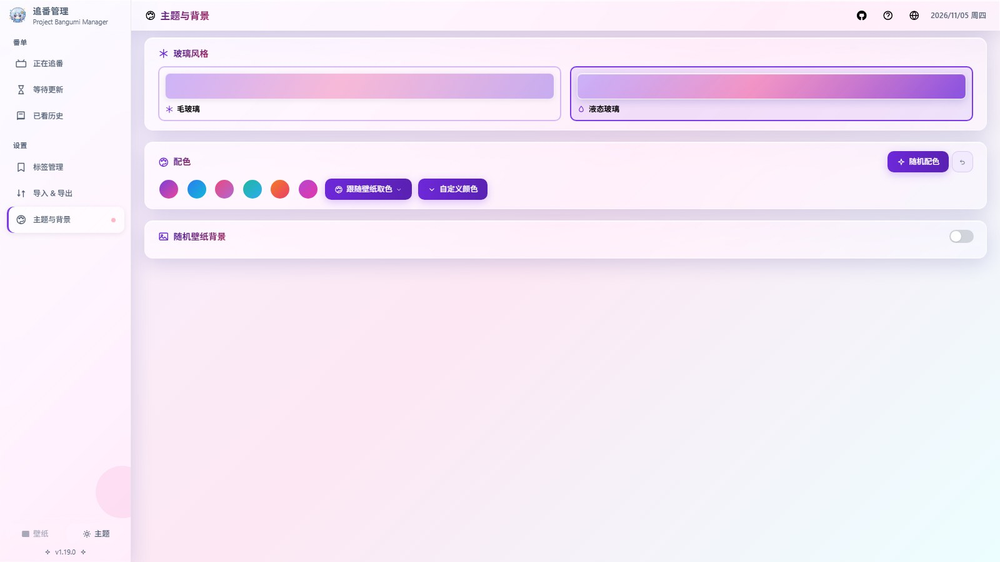
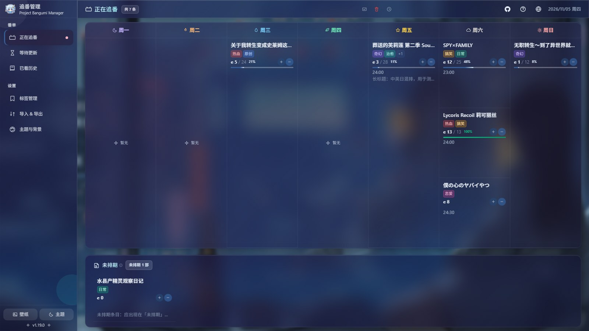

<p align="center">
  
</p>

<h1 align="center">PBM — Project Bangumi Manager</h1>

<p align="center">
  <b>HTML ファイル 1 枚に、視聴リストを全部。</b><br />
  ブラウザだけで動く · 単一ファイル配布 · データは 100% 手元に
</p>

<p align="center">
  <a href="https://emilelu.github.io/pbm.html"></a>
  
  
  
  
  
</p>

<p align="center">
  <a href="README.md">中文</a> · <a href="README.en.md">English</a> · <b>日本語</b>
</p>



## 3 ステップで始める

1. ビルド済みの `dist/index.html` を落とす。または[オンラインデモ](https://emilelu.github.io/pbm.html)を開く
2. その HTML ファイルを**ダブルクリック**する（導入はこれだけ。WASM を内包しているので `file://` でも動きます）
3. 端末を移すときは、サイドバーの「インポート & エクスポート → データベースのバックアップ (.db)」でファイルごと持ち出す

Node の実行環境も、アカウントも、サーバーも要りません。バックエンドが無いので「サービス終了」もありません。

## これは何か

PBM が扱うのは作品のライフサイクル全体、**更新待ち → 視聴中 → 視聴履歴** です。

始まりは 2020 年 2 月の Excel シート 1 枚でした。当時は「毎週セルを手で埋める」ことが視聴管理でした。
6 年経った今も**ファイルは 1 枚**のままですが、そのセルは週カレンダー、進捗バー、タグ絞り込み、
テーマ壁紙、5 形式の入出力に育っています。

データベースはブラウザ内で動く本物の SQLite（`sql.js` の WASM 版）で、保存先は IndexedDB。
タブを閉じても、ネットを切っても、ネットの無い別の PC にファイルをコピーしても、データはそのままです。

## 使う理由

- 📅 **週カレンダー** — 月曜から日曜まで 1 日 1 列。今日どれを見るか、残り何本かが一目で分かる
- 🔄 **3 つの状態** — 更新待ち・視聴中・視聴履歴をクリックまたは右クリックメニューで移動、進捗も一緒に移る
- 🏷️ **タグ** — 内蔵 12 個（熱血／日常／恋愛／ファンタジー…）＋自作タグ。一覧はタグで複数選択（OR）絞り込み
- 🎨 **見た目** — プリセット配色 6 種、壁紙からの自動配色、毎回ランダム配色。すりガラス／リキッドガラスの 2 段階
- 🌏 **3 言語** — 中文 / English / 日本語（589 キーを 1 件ずつ突き合わせ）、ダークモードも本格対応
- 📦 **5 形式で相互運用** — xlsx / csv / json / md / db。一括バックアップも人が読めるテキスト出力も揃っている
- 🔒 **データは外に出ない** — サーバー無し、解析タグ無し、ログイン無し。データはあなたのディスクの中だけ

## スクリーンショット

### 視聴中 — 月曜から日曜へ横に並ぶ

曜日ごとの列、放送時刻順、カードに進捗 `e 8 / 12  67%` がそのまま出ます。
プラス／マイナスを 1 回押せば 1 話記録。今月更新される更新待ち作品はページ上部で知らせます。


### 更新待ち — 放送前の作品を待機列に

テーブル＋ページ送り、予定日順、まとめて追加、ドラッグで並べ替え。
「今期新番」ボタンで今クールの一覧へ直行できるので、追加は 1 クリックで済みます。
列幅は固定なので広い画面でも日付列が間延びせず、狭い画面ではカード内で横スクロールします。



### 視聴履歴 — 年ごとに整理

年ごとのグループと「今年／累計」の件数。年ラベルは改名も追加もできます。
1 件ごとにタグ・リンク・メモを付けられるので、後から「なぜ見たんだっけ」を思い出せます。



### タグ管理 — 内蔵タグは消せないが、改名と色変更はできる

内蔵 12 個はそのまま使え、自作タグは自分で色を決められます。改名は各項目にも反映。
内蔵タグは改名・色変更のみで削除できません。意味を失ったタグが黙って消えることはありません。



### インポート & エクスポート — 5 形式を双方向に

インポートはファイル種別から形式を自動判定するので、形式を選ぶ必要はありません。
エクスポートは形式ごとに 1 クリック。`.db` はデータベース全体のバックアップで、復元前にはロールバック用スナップショットを残します。



### テーマと背景 — 壁紙ごと着せ替え

すりガラスとリキッドガラス、プリセット 6 種、壁紙からの自動配色。
ランダム壁紙は「起動ごとに変える／今の 1 枚に固定」を選べ、暗幕の濃さとぼかし量も調整できます。
壁紙の抽出とプレビューは自前 CORS プロキシ（`useAppearance.js` 冒頭で設定）を優先し、
届かない場合は静かに縮退します。カスタム直リンクの URL はプロキシには送信されません。



### ダークモード

ライトテーマにフィルタを掛けただけではありません。ガラスの重なり、文字コントラスト、
壁紙の暗幕をダーク用に個別調整しています。



## ソースから動かす

```bash
pnpm install
pnpm dev      # 開発サーバー
pnpm build    # dist/index.html を出力（HTML 1 ファイル、WASM を内包）
pnpm test     # 476 テスト / 14 ファイル
```

ビルド成果物は約 1.6 MB、gzip で約 709 KB。WASM は gzip にしてから base64 で内包し、
実行時はブラウザ標準の `DecompressionStream('gzip')` を優先、非対応環境では同梱の純 JS inflate に落ちます。
どちらの経路もネットワークを使わないので、`file://` でも動作します。

<details>
<summary><b>ページ別の機能一覧</b></summary>

| ページ | できること |
|---|---|
| 視聴中 `/watching` | 週グリッド、時間順ソート、話数 ±（ゼロ埋め・小数対応）、進捗パーセント、リンクテンプレート、今月の更新リマインド |
| 更新待ち `/remaining` | テーブル＋ページ送り、日付順ソート、ドラッグで並べ替え、まとめて追加、今期新番へのショートカット、検索・タグ絞り込みはトップバーに常駐 |
| 視聴履歴 `/watched` | 年ごとのグループ、日付順ソート、年ラベルのカスタム、今年と累計の統計、検索・タグ・年絞り込みはトップバーに常駐 |
| タグ `/tags` | 内蔵 12 個＋自作。作成・改名・色変更・削除。内蔵は削除不可、改名は各項目にも反映 |
| テーマ `/appearance` | プリセット配色 6 種、壁紙から抽出または毎回ランダム、すりガラス／リキッドガラス、マスクとぼかしの微調整 |
| インポート `/import` | Excel 取り込みページ：シート自動判定、週レイアウト解析、結合セルの年、ハイパーリンク、インポートログ |
| インポート & エクスポート `/transfer` | 取り込みは形式自動判定、書き出しは xlsx / csv / json / md / db の 5 形式 |

**共通**

- 中・英・日（596 キーを一致）、CJK フォントは言語ごとに切替；ライト／ダーク／システム追従
- サイドバーは折りたたみ可能（15rem ↔ 4rem）、「リスト／データ／設定」の区分、収納時はアイコン＋吹き出し
- 共通の色選択コンポーネント；ルート文字サイズはビューポートに応じて拡大
- レスポンシブ：検索・タグ・年絞り込みは >1100px でトップバーに常駐、≤1100px でアイコンに折りたたみ
  （タップでパネル入力）。≤1100px でページ操作を「その他の操作」メニューに集約、≤900px でサイドバーが
  アイコン表示に自動収納。タイトル・件数・日付は常に一行；表は狭い画面でも列を潰さず、
  カード内で横スクロールする
- 表の列幅を固定（番号／日付／リンク／メモ）。広い画面で日付列が画面の 1/3 を占めて
  `2026/01` 一行しか入らない、といった無駄がなくなる
- 初回データ到着まではスケルトン行を表示し、「記録なし」を一瞬誤表示しない
- `.db` の一括バックアップと復元前スナップショット；構造化インポートは成功／失敗件数を集計
- キーボードだけで操作可能、フォーカストラップ、Esc で閉じる；ヘルプにショートカットを集約
- `prefers-reduced-motion` を尊重：アニメーションとトランジションをほぼゼロ時間に短縮

</details>

<details>
<summary><b>技術スタックとプロジェクト構成</b></summary>

Vue 3 · Vite 6 · TailwindCSS 3 · vue-router 4 · sql.js 1.14（WASM）· SheetJS 0.20 · vite-plugin-singlefile

```
src/
├── App.vue        ルートコンポーネント（サイドバーの区分・折りたたみ、入出力メニュー）
├── components/    AppIcon · WatchingCard · ColorPicker · TagSelector · TagFilter · HelpDialog
├── composables/   テーマ、外観、i18n、日付、話数、フォーカストラップ…
├── db/            index.js（テーブル定義・マイグレーション）、excelImporter、excelExporter、structuredImporter
├── locales/       3 言語パック zh / en / ja（589 キー）
├── router/        ルート（/tags・/appearance・/transfer を含む）
├── views/         視聴中 · 更新待ち · 視聴履歴 · 取り込み · タグ · テーマ · インポート&エクスポート
└── style.css      グローバルスタイルとテーマ変数
```

</details>

<details>
<summary><b>実装メモと踏んだ罠</b></summary>

以下はすべて実際に踏んだ不具合で、コード内にもコメントを残してあります。改修前に目を通す価値があります。

**単一ファイルと `file://`**
- WASM は内包するしかありません。`file://` では WASM の `fetch` が CORS で即座に遮断されます。内包方式は gzip + base64
- 展開結果は「長さ + WASM マジックナンバー」を必ず検証し、展開器が壊れていたら即座に例外。WebAssembly に壊れたバイト列を渡すことはありません
- `index.html` とエントリの両方で `darkreader-lock` を宣言します。Dark Reader の動的モードは `::before/::after` を剥がすため、壁紙が消えます

**SQLite WASM + IndexedDB**
- 書き込みのたびに `db.export()` するのは O(n²)。書き込みは「ダーティ」を立てるだけにし、microtask で 1 回の export + 1 回のトランザクションにまとめます
- 読み込みに失敗したら**空のデータベースを作らない**。空DBでユーザーの既存データを上書きするより、エラーで止まる方がましです
- `.db` の取り込みはまず候補インスタンスでスキーマを検証し、成功後に差し替えます。壊れたファイルでセッションが `database is closed` になることはありません
- `addWatched({ name })` に日付が無いとき、正規化は `undefined` ではなく空文字を返す必要があります。さもないと sql.js が `tried to bind a value of an unknown type (undefined)` という裸の文字列を投げます
- 年で絞り込むときの前方一致の上界は `label + '0'`（`label + '/1'` ではない）。そうしないと `2021/10`〜`2021/12` が黙って落ちます

**配置とアニメーション**
- `backdrop-filter` を持つ祖先（本アプリの `.glass` カードの大半）は `position: fixed` の包含ブロックになります
- そのためダイアログ・吹き出し・ドロップダウンはすべて body に `Teleport` し、`fixed` + `getBoundingClientRect()` で位置決めします
- テーマ色は **RGB の三つ組**（`--c-primary: 124 58 237`）。`rgb(var(--c-primary) / 0.2)` と書きます。`rgba(var(--c-primary), 0.2)` は不正な文法で、宣言ごと黙って捨てられます
- `v-if` と `v-for` を同じ要素に書いてはいけません。離場する要素は文書フローから外す必要があります。さもないと Vue の FLIP が移動量を 0 と判定し、残りが瞬時に飛びます
- ガラスの部分木に無限アニメーションを置かないこと。そのガラスが毎フレーム背景を再取得してぼかし、GPU を飽和させます

**i18n**
- vue-i18n を入れず 60 行の自作 i18n。フォールバックは「現在の言語 → 中国語 → 生のキー」なので、翻訳漏れがすぐ見えます
- 3 言語パックのキー集合と `{name}` プレースホルダは完全一致が必須で、`tests/i18n.test.js` が見張っています

</details>

## ドキュメント

- [変更履歴](CHANGELOG.md)
- [コード監査・修正レポート](review/SUMMARY.md)
- [中文 README](README.md) · [English README](README.en.md)

## License

MIT
