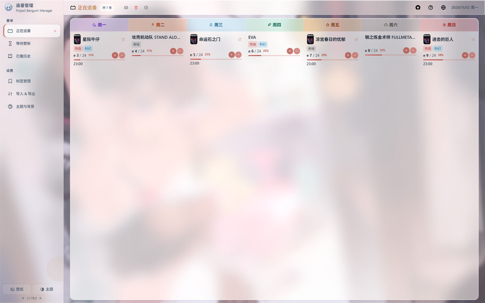
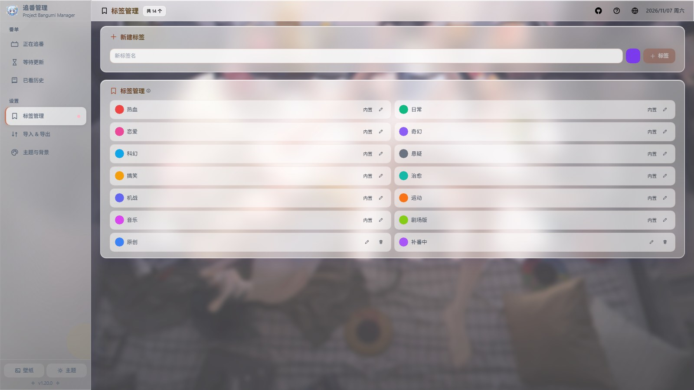
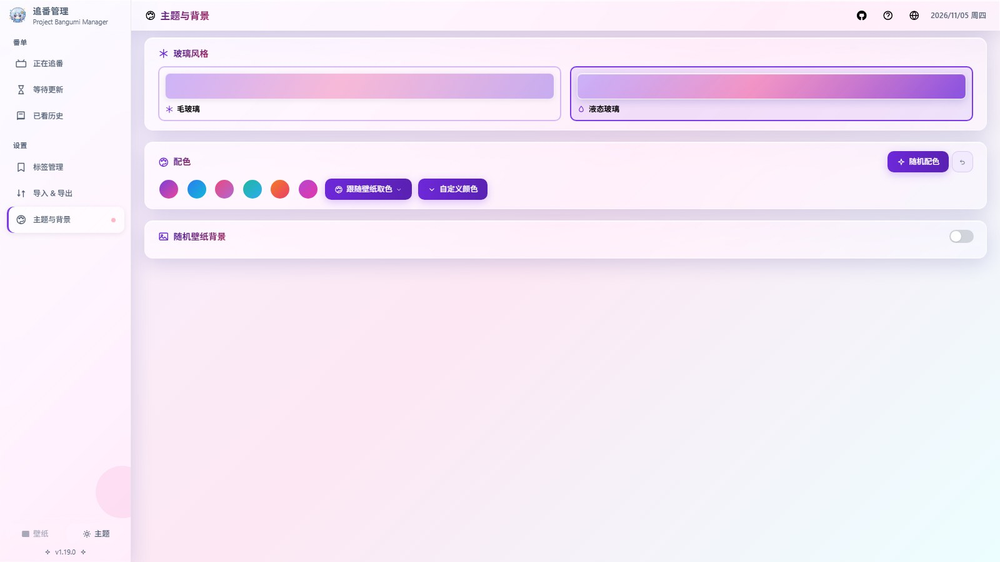
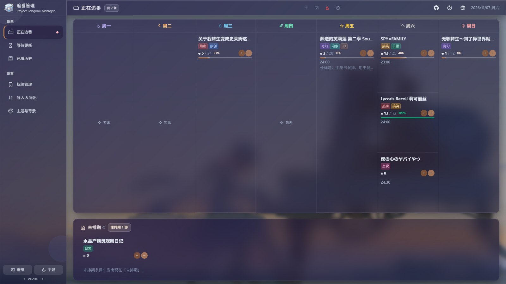

<p align="center">
  
</p>

<h1 align="center">PBM — Project Bangumi Manager</h1>

<p align="center">
  <b>一个 HTML 文件，装下你所有的追番。</b><br />
  纯浏览器运行 · 单文件部署 · 数据 100% 留在本机
</p>

<p align="center">
  <a href="https://emilelu.github.io/pbm.html"></a>
  
  
  
  
  
</p>

<p align="center">
  <b>中文</b> · <a href="README.en.md">English</a> · <a href="README.ja.md">日本語</a>
</p>



## 三步开始用

1. 下载构建产物 `dist/index.html`，或直接打开[线上试玩](https://emilelu.github.io/pbm.html)
2. **双击**那个 HTML 文件，浏览器打开就能用（`file://` 协议也照跑，WASM 已内联）
3. 要换设备？侧栏「导入 & 导出 → 数据库备份 (.db)」，带上文件走就行

不用装 Node、不用注册账号、不用连服务器。没有后端，也就没有"服务到期"。

## 它是什么

PBM 管的是追番的完整生命周期：**等番 → 追番 → 已看**。

项目始于 2020 年 2 月的一张 Excel 表——那时候记番剧就是"每周手动填格子"。六年下来，
它长成了现在这个样子：仍然是**一个文件**，但格子变成了周历视图、进度条、标签筛选、
主题壁纸和五种格式的导入导出。

数据库是跑在浏览器里的 SQLite（`sql.js` 的 WASM 版），数据落在 IndexedDB。
关掉网页、断网、甚至把文件拷到另一台没有网络的电脑上，都还是原来那批数据。

## 为什么用它

- 📅 **周历视图** — 周一至周日一列一天，今天该看什么、剩下几部没追，一眼看到底
- 🔄 **三态流转** — 等番、追番、已看之间右键或工具栏一键移动，进度自动带过去
- 🏷️ **标签系统** — 12 个内置标签（热血/日常/恋爱/奇幻…）加自建标签，列表按标签多选筛选
- 🎨 **外观自定义** — 6 套预设配色、跟随壁纸自动取色、每次刷新随机取色，毛玻璃 / 液态玻璃两档
- 🌏 **三语界面** — 中文 / English / 日本語（589 个文案键逐条对齐），外加深色模式
- 📦 **五格式互通** — xlsx / csv / json / md / db，整库备份与可读文本导出都有
- 🔒 **数据不出门** — 没有服务端、没有埋点、没有登录，数据只在你自己的硬盘里

## 截图

### 追番 · 周一至周日排开

按星期分列、按时间排序，卡片上直接显示集数进度 `e 8 / 12 67%`，
加号减号点一下就记完一集。本月有哪些等番即将更新，页面顶部也会提醒。


### 等待更新 · 还没开播的先排队

表格 + 分页，按预计日期排序，支持批量添加与拖动排序；
「本季新番」按钮直达当季新番列表，看到想追的直接拉进来。
列宽固定，宽屏不会把日期列撑成三分之一屏；窄屏则在卡片内横向滚动，列不被压扁。


### 已看历史 · 按年份归档

年份分组 + 本年与累计统计，年份标签可以自己改名或新建；
一条记录同时能挂标签、链接和备注，翻旧账时记得住当时为什么看它。


### 标签管理 · 内置不可删，可改名改色

12 个内置标签开箱即用，自建标签自己配色。改名会同步到所有条目，
内置标签只允许改名改色、不允许删除，避免误删后语义再也找不回来。



### 导入 & 导出 · 五种格式对等

导入按文件类型自动识别，不用手选格式；导出按需选格式，点了就下载。
`.db` 是整库备份，恢复前会自动留一份回滚快照。


### 主题与背景 · 连同壁纸一起换

毛玻璃与液态玻璃两档质感、6 套预设配色、跟随壁纸自动取色，
随机壁纸背景可设"每次打开换一张"或"固定当前这张"，遮罩浓度与模糊强度都能微调。



### 深色模式

不是简单反色：深色下玻璃卡片的层次、文字对比度和壁纸遮罩都单独调过。



## 从源码跑起来

```bash
pnpm install
pnpm dev      # 开发服务器
pnpm build    # 产物 dist/index.html（单个 HTML，WASM 已内联）
pnpm test     # 473 用例 / 14 文件
```

内置产物约 1.6 MB，gzip 后约 707 KB。WASM 先 gzip 再 base64 内联，
运行时优先走浏览器原生 `DecompressionStream('gzip')`，老浏览器回落到内置的纯 JS inflate——
两条路径都不联网，`file://` 下都可用。

<details>
<summary><b>功能一览（按页面）</b></summary>

| 页面 | 能力 |
|---|---|
| 追番 `/watching` | 周历布局、时间排序、集数 ±（补零/小数）、进度百分比、链接模板、本月等番提醒 |
| 等番 `/remaining` | 表格 + 分页、日期排序、拖动排序、批量添加、季度新番直达、标签筛选 |
| 已看 `/watched` | 年份分组、日期排序、年份标签自定义、本年与累计统计、标签筛选 |
| 标签 `/tags` | 内置 12 个 + 自建；新建/改名/改色/删除，内置不可删，改名同步到条目 |
| 主题 `/appearance` | 6 套预设配色、跟随壁纸取色或每次随机、毛玻璃/液态玻璃、遮罩与模糊微调 |
| 导入 `/import` | Excel 导入页：工作表识别、周历解析、合并单元格年份、超链接、导入日志 |
| 导入 & 导出 `/transfer` | 导入自动识别格式；导出 xlsx / csv / json / md / db 五种 |

**全局**

- 中英日三语（589 key 对齐），中日字体按语言走各自家族；日间 / 暗黑 / 跟随系统
- 侧栏可折叠（15rem ↔ 4rem）、分「番单 / 数据 / 设置」区，收起只留图标与气泡
- 统一取色组件；根字号随视口缩放，高分屏整体放大
- 响应式：≤1100px 页面操作收进「更多」菜单，≤900px 侧栏自动收起为图标模式，
  标题、计数与日期始终保持单行；表格在窄屏由卡片内部横向滚动，列宽不被压扁
- 表格列宽固定（序号 / 日期 / 链接 / 备注各占合理宽度），宽屏下不再出现
  「日期列占三分之一屏宽却只放一行 2026/01」的浪费
- 数据首帧到达前渲染骨架行，不会先闪一下「暂无记录」
- `.db` 整库备份与恢复前回滚快照；结构化导入汇总成功/失败数
- 全键盘可操作、焦点陷阱、Esc 关闭；帮助弹窗收纳快捷键
- 尊重系统「减弱动态效果」（`prefers-reduced-motion`）：全站动画与过渡会降到近零时长

</details>

<details>
<summary><b>技术栈与项目结构</b></summary>

Vue 3 · Vite 6 · TailwindCSS 3 · vue-router 4 · sql.js 1.14（WASM）· SheetJS 0.20 · vite-plugin-singlefile

```
src/
├── App.vue        根组件（侧栏分区/折叠、导入与导出菜单）
├── components/    AppIcon · WatchingCard · ColorPicker · TagSelector · TagFilter · HelpDialog
├── composables/   主题、外观、i18n、日期、集数、焦点陷阱…
├── db/            index.js（表结构/迁移）、excelImporter、excelExporter、structuredImporter
├── locales/       三语语言包 zh / en / ja（589 key）
├── router/        路由（含 /tags、/appearance、/transfer）
├── views/         追番 · 等番 · 已看 · 导入 · 标签 · 主题 · 导入&导出
└── style.css      全局样式与主题变量
```

</details>

<details>
<summary><b>实现笔记与踩过的坑</b></summary>

这些坑都是真实踩到、并且在代码里留了注释的，改代码前值得先看一眼。

**单文件与 `file://`**
- WASM 必须内联，否则 `file://` 下 `fetch` WASM 会被 CORS 直接拦掉；内联方案是 gzip + base64
- 解压结果强制校验「长度 + WASM 魔数」，解压器出问题时立刻抛错，绝不给 WebAssembly 喂坏字节
- `index.html` 与入口都要声明 `darkreader-lock`：Dark Reader 的动态模式会剥掉 `::before/::after`，壁纸会消失

**SQLite WASM + IndexedDB**
- 落盘不能每次写都 `db.export()`（O(n²)）：改成「写操作只标脏，microtask 合并成一次 export + 一次事务」
- 读取失败时**不建空库**：宁可停在错误上，也不要用空库覆盖掉用户原有数据
- 导入 `.db` 先在临时实例上建表校验，成功后替换实例；坏文件不会把当前会话打成 `database is closed`
- `addWatched({ name })` 不传日期时，归一化必须返回空串而非 `undefined`；
  否则 sql.js 会抛裸字符串 `tried to bind a value of an unknown type (undefined)`
- 按年份查已看时，前缀区间上界要取 `label + '0'`（不是 `label + '/1'`），
  否则 `2021/10`~`2021/12` 会整批漏掉

**定位与动画**
- 祖先只要带 `backdrop-filter`（本站大量 `.glass` 卡片），就会成为 `position: fixed` 的包含块
- 所以弹窗、气泡、下拉菜单全部 `Teleport` 到 body，再用 `fixed` + `getBoundingClientRect()` 定位
- 主题色是 **RGB 三元组**（`--c-primary: 124 58 237`）：写 `rgb(var(--c-primary) / 0.2)`，
  `rgba(var(--c-primary), 0.2)` 是非法语法，整条声明会被静默丢弃
- `v-if` 不能和 `v-for` 写在同一个元素上；离场元素必须脱离文档流，否则 Vue 的 FLIP 会判定位移为 0，
  其余元素直接瞬跳
- 玻璃子树里不要放无限动画：会让那块玻璃每帧重新捕获背景并模糊，GPU 持续满载

**i18n**
- 自建 60 行 i18n（不引 vue-i18n）：回退链是「当前语言 → 中文 → 原 key」，漏翻能立刻看出来
- 三语 key 集合与 `{name}` 占位符必须完全一致，由 `tests/i18n.test.js` 守着

</details>

## 文档

- [版本变更记录](CHANGELOG.md)
- [代码审计与修复报告](review/SUMMARY.md)
- [English README](README.en.md) · [日本語 README](README.ja.md)

## License

MIT
